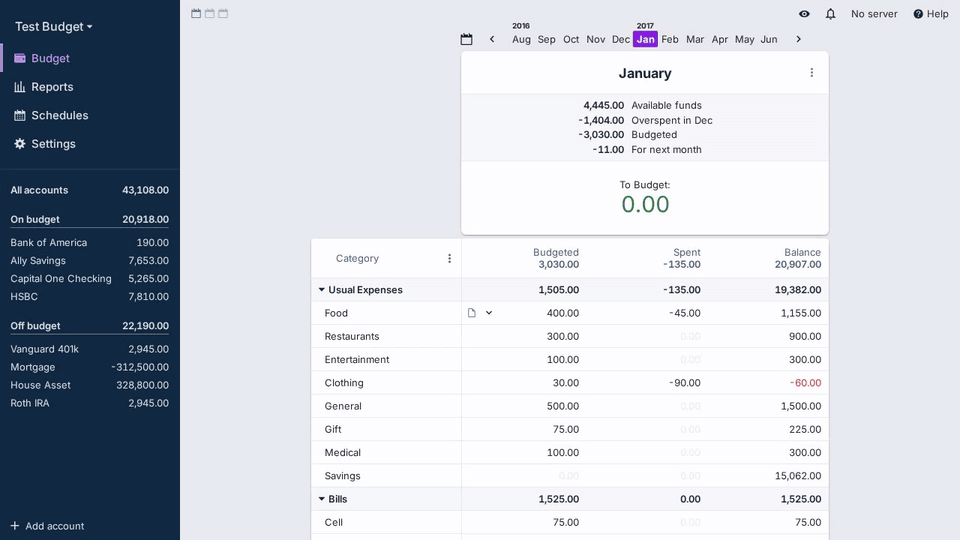

# actual — iky's fork

This is a fork of [Actual Budget](https://actualbudget.org). Upstream's own
[README](https://github.com/actualbudget/actual#readme) is still the right
place to read what Actual is and how to use it; this file is about what
**this fork** adds.

The fork's headline is a **keyboard-driven import review**: when you import
an OFX file, Actual shows you every row the file contains, what it thinks of
each one, and lets you fix, accept, drop, split, transfer and rule them
without ever touching the mouse. It is opt-in, and turning it on does not
change how anything else works.

Everything here is a fork-local addition. Upstream is MIT licensed and is
copyrighted by its authors; see [License](#license).

## The import review



_That is the real app, recorded by a Playwright script that drives it from
the keyboard: turning the review on from the command bar, importing a file,
fixing a row the trust level held back, making a rule from it, accepting
everything, and applying the import. The recording lives in
`packages/desktop-client/demo/` and the script that turns it into this GIF
is `scripts/build-import-demo-gif.mjs`._

### Turning it on

Press <kbd>Ctrl</kbd>+<kbd>K</kbd> (or <kbd>⌘</kbd>+<kbd>K</kbd>), search for
**Keyboard import review**, and choose it. Do the same thing again to turn it
off. The setting is a synced preference, so it follows you to your other
devices.

It applies to `.ofx` and `.qfx` files only. Everything else — CSV, QIF, CAMT
— keeps Actual's own import dialog.

### The keys

| Key                                                           | What it does                                           |
| ------------------------------------------------------------- | ------------------------------------------------------ |
| <kbd>j</kbd> / <kbd>k</kbd>                                   | Move to the next or previous row                       |
| <kbd>↓</kbd> / <kbd>↑</kbd>                                   | The same, with the arrow keys                          |
| <kbd>g</kbd> / <kbd>G</kbd>                                   | Jump to the first or last row                          |
| <kbd>a</kbd>                                                  | Accept the row and move on                             |
| <kbd>Ctrl</kbd>+<kbd>a</kbd>                                  | Accept the row and stay on it                          |
| <kbd>Ctrl</kbd>+<kbd>Shift</kbd>+<kbd>a</kbd>                 | Accept the row even if the review is not sure about it |
| <kbd>r</kbd>                                                  | Drop the row and move on                               |
| <kbd>u</kbd>                                                  | Undo the last decision                                 |
| <kbd>e</kbd>                                                  | Edit the row's fields one after another, then move on  |
| <kbd>p</kbd>                                                  | Edit the payee                                         |
| <kbd>c</kbd>                                                  | Edit the category                                      |
| <kbd>m</kbd>                                                  | Edit the notes                                         |
| <kbd>Shift</kbd>+<kbd>4</kbd>                                 | Edit the amount                                        |
| <kbd>d</kbd>                                                  | Edit the date                                          |
| <kbd>s</kbd>                                                  | Split the row across categories                        |
| <kbd>t</kbd>                                                  | Make the row a transfer                                |
| <kbd>Shift</kbd>+<kbd>E</kbd>                                 | Open the rules on this row                             |
| <kbd>1</kbd> / <kbd>2</kbd> / <kbd>3</kbd>                    | Use the paranoid, cautious or trusted trust level      |
| <kbd>Shift</kbd>+<kbd>A</kbd> / <kbd>Shift</kbd>+<kbd>R</kbd> | Accept or drop every row                               |
| <kbd>w</kbd>                                                  | Put the review aside, and pick it up again later       |
| <kbd>Ctrl</kbd>+<kbd>S</kbd>                                  | Apply the import                                       |
| <kbd>Esc</kbd>                                                | Close the review                                       |
| <kbd>?</kbd>                                                  | Show the keys                                          |

_The keys as of `1c230d190`, the last commit that touched
`packages/desktop-client/src/import-review/keymap.ts`. That file is the
source of truth for the KEYS; the NOTATION follows the review's own hint
strip, which writes `?` for `shift+slash`. When either changes, this
table changes with it._

### The chain

<kbd>e</kbd> is the key the review is built around. One press walks the
focused row's fields — the payee, then the category, then the notes, and the
amount if the row is flagged about it — and each field you confirm moves on
to the next. The last one closes the editor and moves you to the next row,
because that row is finished. A row that took four keypresses and four
trips through a payee picker now takes one.

The chain leaves out the fields it has no business offering:

- **the category** of a transfer (a transfer's category is the account it
  transfers to) and of a split (a split's legs carry their own);
- **the amount** of a split, because the legs have to add up to it and the
  split editor is where it is fixed;
- **the amount** of a row that is not flagged about it, because the amount
  is the last thing a person checks and there is no reason to stop there
  when the amount is fine;
- **any field a rule already controls**, because the editor would refuse the
  commit and only produce a refusal.

It starts past a ruled payee rather than opening on a field you cannot
change, and it follows the row: give a transfer row a payee and the transfer
goes away, so the row becomes an ordinary transaction and the chain offers
its category next.

### The trust levels

The review holds back the rows it is not sure about, and says why in the
status column. How sure is a choice you make, with <kbd>1</kbd>,
<kbd>2</kbd> or <kbd>3</kbd>:

|                                   | paranoid | cautious | trusted  |
| --------------------------------- | -------- | -------- | -------- |
| a payee the budget does not know  | held     | held     | flagged  |
| a row that repeats an earlier one | held     | skipped  | flagged  |
| a fuzzy payee match               | held     | flagged  | flagged  |
| a payee that would be created     | flagged  | flagged  | flagged  |
| an auto-detected transfer         | flagged  | flagged  | flagged  |
| **an unusable amount or date**    | **held** | **held** | **held** |

The last row is the exception, and it is deliberate: broken data is not a
matter of trust. A row whose amount was unusable would be written to the
budget as a real $0 transaction, and a row with no usable date is rejected
by the import itself. Those rows cannot be waved through — they have to be
**fixed**, which clears the flag. Everything else the gate holds can be
accepted deliberately with <kbd>Ctrl</kbd>+<kbd>Shift</kbd>+<kbd>A</kbd>, and
an override survives a stricter level.

### The rules

The review shows what the rules did to a row, in the ownership zone: which
rule owns which field, and what it sets. A field a rule controls is shown as
a read-only field — the rule's value, in the rule lock's own colour, with a
tag glyph beside it — so you can see the rule without hunting for it.

<kbd>Shift</kbd>+<kbd>E</kbd> opens the rules on the row: the ones that
touched it, and the ones it could grow. A rule is created **only when you
ask for it**. No _rule_ is created on its own: picking a payee does not
quietly make a vendor rule, because a rule applies to every future
transaction with that vendor, and that is your decision to make. (The older
vendor map still learns silently from payee choices; it is deprecated in
favour of explicit rules and will be removed in a follow-up.)

### Splits, transfers and the rest

- <kbd>s</kbd> splits a row across categories, with the legs editable and a
  "distribute" button that fills the empty leg.
- <kbd>t</kbd> makes a row a transfer, and the transfer editor refuses the
  things a transfer cannot do — a split row cannot become a transfer.
- <kbd>u</kbd> undoes the last decision, including a bulk one: one undo
  takes back an accept-everything.
- <kbd>w</kbd> puts the review aside. It is kept on the device you made it
  on — not synced — and the command bar brings it back.
- <kbd>Ctrl</kbd>+<kbd>S</kbd> applies the import. The rows that land are
  **marked**, the same bold the app's own import gives a transaction it has
  just brought in.

Every row has a detail section under the list, in four zones: the
**evidence** the row was built from, the **reason** it is held or flagged,
the **ownership** (the rules that touched it), and the **actions** the row
has, each labelled with the key that does it.

### What it cannot do

These are the things a person would otherwise find out the hard way — after
the import, when the transactions are already in the budget.

- A file is imported into the account you opened the review for. The review
  reads the account details in an OFX file to warn about a mismatch and to
  suggest an account on the standalone import page, but it still cannot split
  a file with two bank statements — those all land in the chosen account.
- The payee names you remember are remembered for the whole budget, not for
  one account. The same vendor name in two accounts keeps only the last
  choice.
- A rule you create here applies to every transaction with that vendor,
  from now on. It does not change the transactions you already have. A
  transfer rule is scoped to the account it was created from; if several
  same-amount transfers land on nearby days, the review warns when it cannot
  tell which one a row belongs to.

- A split that was imported before is matched to the old one by the bank's
  id. Its legs are matched by position, so a leg you added by hand may be
  overwritten or deleted.
- The import is not all-or-nothing. Rows are updated first and imported
  second, so a failure can leave the updates behind.

## The domain layer under it

The review's decisions live in `packages/loot-core/src/server/transactions/import/review/`,
which is plain functions over plain data: the preview state, the flag
pipeline and the trust-level matrix, the gate that turns flags into
outcomes, the fuzzy payee resolver and its cache, the vendor map, the rule
effects, and the split primitives.

None of it touches React, the database, or the network, which is why it can
be tested without a browser and why the desktop client stays a keyboard
surface rather than a pile of rules.

## A faster e2e loop

The Playwright suite can run against the prebuilt bundle instead of the dev
server, which is about four times faster and uses a quarter less memory.
The commands and the measurements are in `AGENTS.md`, under "Running E2E
tests fast".

## The demo recording

The GIF at the top is generated, not hand-made, so it can be regenerated
when the review changes:

```bash
# once, when the app source changes
REACT_APP_NETLIFY=true yarn build:browser --skip-translations

# record the flow
yarn workspace @actual-app/web exec playwright test --config=playwright.demo.config.ts

# turn the recording into the GIF
node scripts/build-import-demo-gif.mjs
```

The recording lives outside the e2e suite on purpose: `yarn e2e` never runs
it, and CI never waits for it.

## What this fork touches upstream

The fork is **74 commits ahead of upstream's `master`** and 3 behind it, as
of this commit. Everything else is new:

|                                                             |                              |
| ----------------------------------------------------------- | ---------------------------- |
| `packages/desktop-client/src/import-review/`                | the whole feature — 60 files |
| `packages/loot-core/src/server/transactions/import/review/` | the domain layer — 34 files  |

The upstream application files the fork edits are:

|                                                                   |                                                                  |
| ----------------------------------------------------------------- | ---------------------------------------------------------------- |
| `packages/desktop-client/src/components/CommandBar.tsx`           | the command bar entry                                            |
| `packages/desktop-client/src/components/Modals.tsx`               | the modal registry                                               |
| `packages/desktop-client/src/components/accounts/Account.tsx`     | the import button                                                |
| `packages/desktop-client/src/components/FinancesApp.tsx`          | the standalone import page route                                 |
| `packages/desktop-client/src/components/sidebar/Sidebar.tsx`      | the import page shortcut                                         |
| `packages/desktop-client/src/modals/modalsSlice.ts`               | the modal's slice                                                |
| `packages/loot-core/src/server/accounts/app.ts`                   | the accounts server                                              |
| `packages/loot-core/src/server/accounts/sync.ts`                  | the accounts sync                                                |
| `packages/loot-core/src/server/transactions/import/ofx2json.ts`   | reads the bank/account identity from OFX files                   |
| `packages/loot-core/src/server/transactions/import/parse-file.ts` | exposes the identities and an identity-only IPC                  |
| `packages/loot-core/src/server/transactions/app.ts`               | registers the identity-only IPC handler                          |
| `packages/loot-core/src/server/transactions/transaction-rules.ts` | the transaction rules                                            |
| `packages/loot-core/src/types/models/transaction.ts`              | the transaction model                                            |
| `packages/component-library/src/themes/source/colors.ts`          | **one colour token** (`ruleLockText`, for the value a rule owns) |

The rest of the upstream footprint is documentation, release notes, and the
e2e fixtures — plus one new file beside the ones above:
`packages/desktop-client/src/modals/modalsSlice.test.ts`.

That shape is the point: a rebase is a small job, because the feature does
not spread itself across the codebase.

## Development

```bash
yarn install
yarn start                       # the web client on :3001
yarn test                        # every package
yarn typecheck
yarn lint:fix
```

The review's own tests:

```bash
yarn workspace @actual-app/web test src/import-review
E2E_USE_BUILD=1 E2E_PORT=3002 yarn e2e e2e/import-review.test.ts --workers=40%
```

## CI on this fork

Upstream runs its CI on [Depot](https://depot.dev)'s runners, which only
support organization-owned repositories. This fork is a personal account, so
every Depot-targeted job would sit in the queue until GitHub cancelled it
after 24 hours. The fork's workflows therefore run on GitHub-hosted runners
(`ubuntu-latest`), which are free for public repositories.

Upstream's 41 workflows were cut down to four, the ones that answer "did
this change break anything":

| Workflow            | What it does                                                                          |
| ------------------- | ------------------------------------------------------------------------------------- |
| `check.yml`         | lint, typecheck, unit tests, dependency constraints, knip, the migration policy check |
| `build.yml`         | builds the API, CRDT, web bundle, CLI and sync server                                 |
| `e2e-test.yml`      | the Playwright functional tests                                                       |
| `docs-spelling.yml` | spell-checks the docs                                                                 |

Plus one fork-local workflow, `docker-fork.yml`, which builds and publishes
the server image.

What was dropped, and why:

- **The publishers** (`docker-nightly`, `docker-release`, `publish-*`,
  `netlify-release`, `electron-*`) all push to the `actualbudget` namespace
  on npm, Docker Hub, Flathub and the app stores. They have no meaning here.
- **The scheduled chores** (`count-points`, `cut-release-branch`,
  `i18n-string-extract-master`, `nightly-theme-catalog-scan`, `stale`) are
  upstream's own release process.
- **The issue and PR bots** are upstream's triage process.
- **`build.yml`'s `mobile` job** runs a full `xcodebuild archive` and a
  Gradle build. That needs 8 vCPU, 24 GB of RAM and 400 GB of disk, which
  GitHub's macOS runner does not have.
- **`e2e-test.yml`'s `vrt` job** compares screenshots against upstream's
  committed snapshots. The import review changes what those pages look
  like, so the snapshots would have to be regenerated on every rebase.

That is the same shape most forks of this repository settle on: keep the
workflows that check your work, delete the ones that publish upstream's
artifacts.

## Running the fork's server

`docker-fork.yml` publishes the sync-server image to this repository's own
GitHub Container Registry namespace on every push to `main`:

```bash
docker compose -f docker/docker-compose.yml pull
docker compose -f docker/docker-compose.yml up -d
```

The tags are `:latest` for the branch head and `:sha-<short-sha>` for each
commit, so a server can be pinned to the build it is running.

The image is built for `linux/amd64` only, on glibc (Debian bookworm). There
is no Alpine flavour and no 32-bit ARM build.

> **A package scoped to a personal account is private on first publish.** The
> first successful run creates `actual-server` as a private package; flip it to
> Public under the repository's **Packages** tab before anyone else can pull
> it.

## Taking upstream's changes

The fork's `main` branch is upstream's release line plus this fork's commits.
Upstream keeps a `release` branch for its stable line and a `master` branch
for work in progress; the fork tracks the former.

> **Never click GitHub's "Sync fork" button.** It merges the parent's default
> branch — upstream's `master` — into the fork's default branch, which is not
> what the fork wants and does not merge cleanly.

To take a new upstream release:

```bash
git fetch upstream release && git fetch origin
OLD=$(git rev-parse origin/release)
git rebase --onto upstream/release "$OLD" main
git push --force-with-lease origin refs/remotes/upstream/release:refs/heads/release
git push --force-with-lease origin main
```

`OLD` has to come from the fork's own `release` mirror. Using
`git merge-base main upstream/master` instead gives a much older base, because
the two upstream lines diverged in May 2026, and would replay the wrong set
of commits.

## Status

Work in progress, on a personal fork, with no release schedule. This is not
a branch waiting to go upstream: the fork is maintained for its own sake,
and it tracks upstream's release line rather than its `master`, so it picks
up upstream's tested releases instead of work in progress. The import review
is usable today and is the fork's focus; the rest of Actual is upstream's,
at upstream's pace.

## License

Actual is MIT licensed, and this fork is distributed under the same terms,
keeping upstream's copyright notice. See [`LICENSE.txt`](LICENSE.txt) for the
full text.

Upstream: <https://github.com/actualbudget/actual> — issues, releases and
all the credit are theirs.
